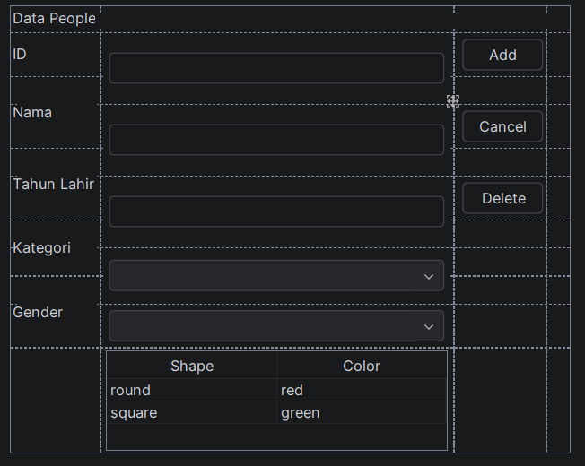
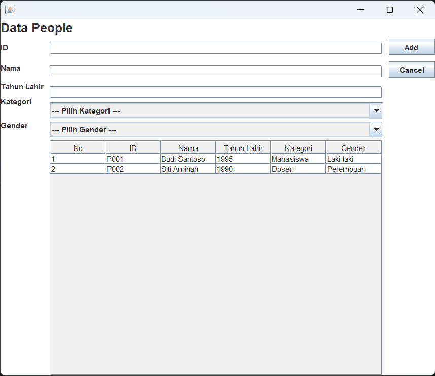
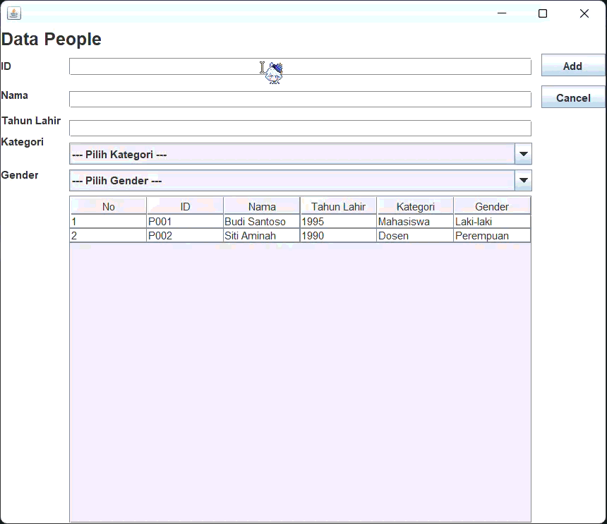
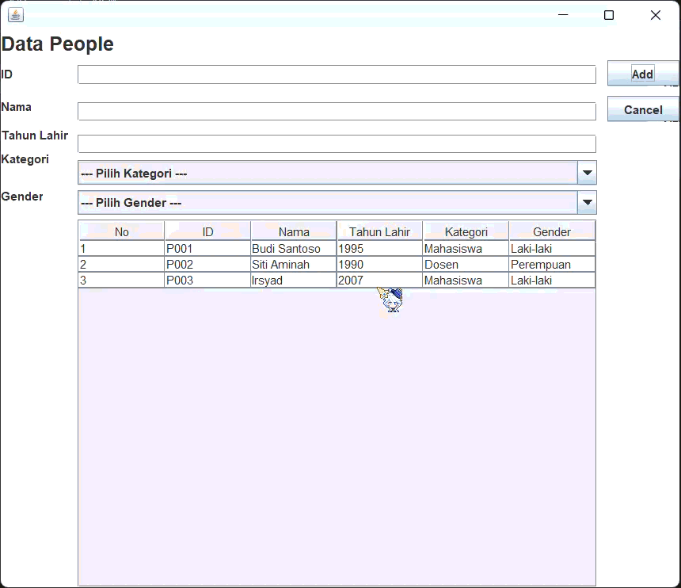
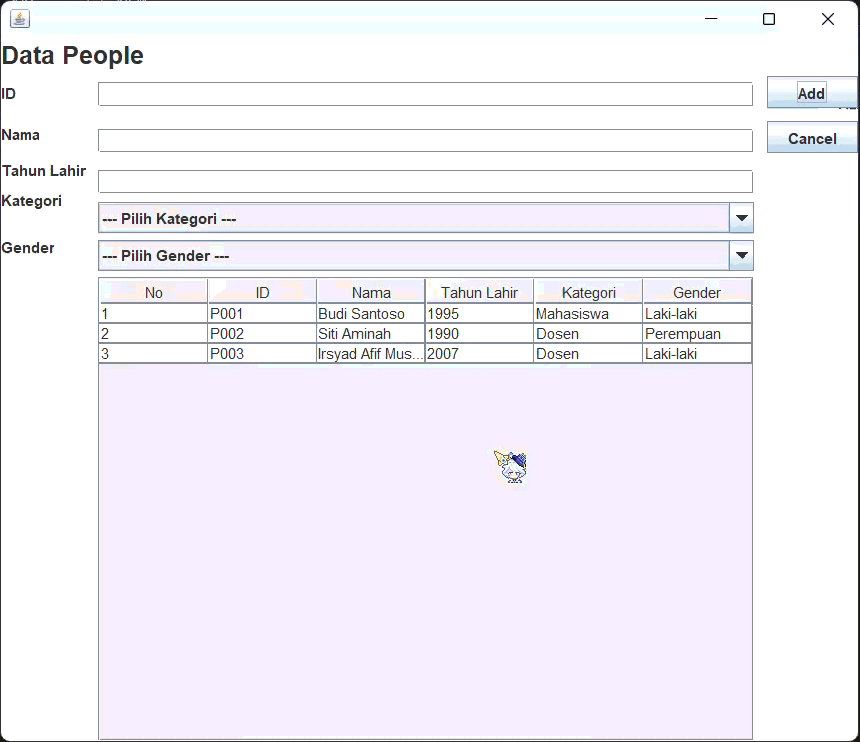

# TP4DPBO2526C1
TUGAS PRAKTIKUM 4 DPBO SWING GUI - PeopleData

---

# ✍️ JANJI
Saya Irsyad Afif Musyaffa dengan NIM 2508023 mengerjakan Tugas Praktikum 4 dalam mata kuliah Desain dan Pemrograman Berorientasi Objek untuk keberkahan-Nya maka saya tidak melakukan kecurangan seperti yang telah dispesifikasikan. Aamiin.

---

# 📌 DESAIN PROGRAM
Program ini dirancang menggunakan Java Swing untuk mengelola data *People* (orang/person) berbasis Graphical User Interface (GUI). Sistem ini menerapkan konsep operasi CRUD, yaitu:
- **Create**: Menambahkan data person baru ke dalam daftar.
- **Read**: Menampilkan seluruh daftar person di dalam tabel.
- **Update**: Memperbarui informasi data person yang sudah dipilih.
- **Delete**: Menghapus data person dari daftar dengan konfirmasi pop-up.

---

## DOKUMENTASI KELAS (CLASS STRUCTURE)

### 1. Class `Person.java`
Merupakan kelas entitas (model) yang menampung atribut data person beserta method pengaksesnya.
**Atribut:**
- String id
- String nama
- int tahunLahir
- String kategori
- String gender

**Method:**
- Constructor Person(String id, String nama, int tahunLahir, String kategori, String gender)
- Getter dan Setter untuk masing-masing atribut.

### 2. Class `PeopleMenu.java` (extends `JFrame`)
Merupakan kelas utama penangan tampilan GUI sekaligus logika bisnis dari aplikasi.
**Komponen GUI Utama:**
- JTextField $\rightarrow$ Input ID, Nama, dan Tahun Lahir
- JComboBox $\rightarrow$ Pilihan Kategori dan Gender
- JTable $\rightarrow$ Menampilkan daftar person yang terdaftar
- JButton $\rightarrow$ Tombol aksi Add/Update, Cancel, dan Delete
  

**Metode Utama:**
- insertData() $\rightarrow$ Menambahkan entri data person baru
- updateData() $\rightarrow$ Memperbarui data person pada baris terpilih
- deleteData() $\rightarrow$ Menghapus data person setelah konfirmasi pengguna
- clearForm() $\rightarrow$ Mengosongkan isian form dan mengembalikan status tombol
- setTable() $\rightarrow$ Memuat ulang dan menyusun data ke dalam DefaultTableModel
- populateList() $\rightarrow$ Inisialisasi data awal (*dummy data*)

---

# 🔄 ALUR KERJA APLIKASI

1. **Inisialisasi Tampilan**:
   Saat aplikasi dijalankan, form input kosong dan tabel langsung menampilkan data awal dari populateList(). Tombol Delete disembunyikan secara otomatis.

2. **Penambahan Data (Create)**:
   Pengguna menginputkan data pada seluruh field lalu menekan tombol **Add**. Sistem akan memvalidasi input tahun lahir dan memasukkan data baru ke dalam tabel.

3. **Pengubahan Data (Update)**:
   Saat baris pada tabel diklik, isi data baris tersebut akan dimuat ke form input. Tombol **Add** otomatis berubah menjadi **Update** dan tombol **Delete** dimunculkan. Pengguna dapat mengubah data lalu menekan tombol **Update**.

4. **Penghapusan Data (Delete)**:
   Saat data dipilih dan tombol **Delete** ditekan, aplikasi akan memunculkan dialog konfirmasi (*Confirmation Prompt*):  
   > *"Apakah Anda yakin ingin menghapus data ini?"*  
   Jika pengguna memilih **Yes**, data akan terhapus dari sistem.

5. **Pembatalan / Reset (Cancel)**:
   Menekan tombol **Cancel** akan mengosongkan seluruh isi form input serta mengembalikan tombol ke mode **Add**.

---

# 🎁 KOMPONEN BONUS (+20 POIN)
- **Komponen Gender (`JComboBox`)**  
  Pengembangan atribut tambahan dilakukan dengan memanfaatkan komponen `JComboBox` (*dropdown*) untuk memilih kategori **Gender** (Laki-laki / Perempuan). Komponen ini merupakan komponen non-`JTextField`, sehingga memenuhi kriteria ketentuan bonus +20 poin.

---

# 📸 DOKUMENTASI JALANNYA PROGRAM

## READ (Tampilan Utama)

## ADD (Tambah Data)

## UPDATE (Ubah Data)

## DELETE (Hapus Data)

